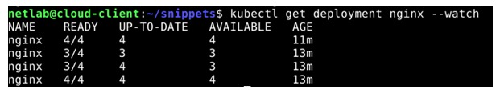
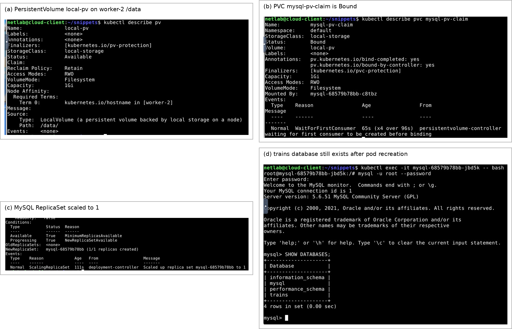
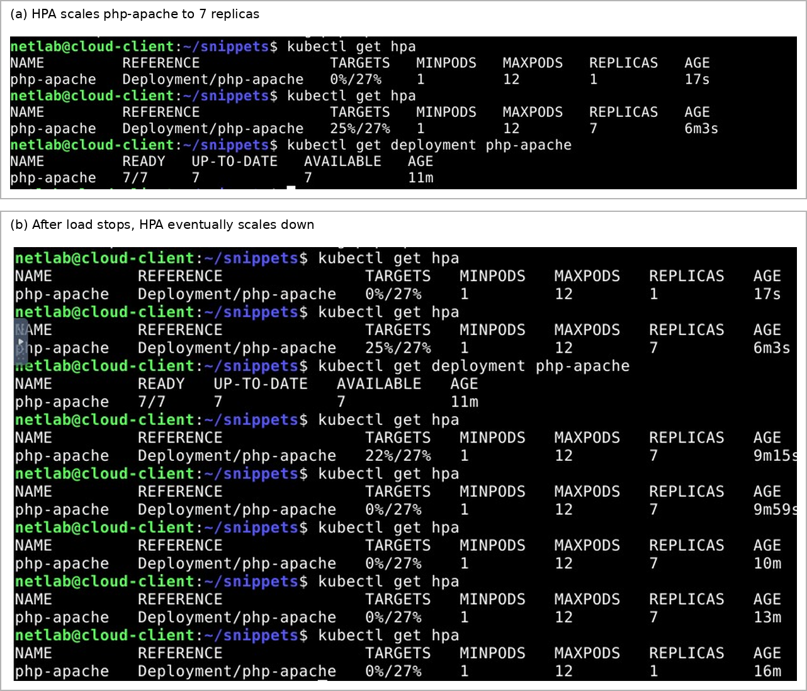
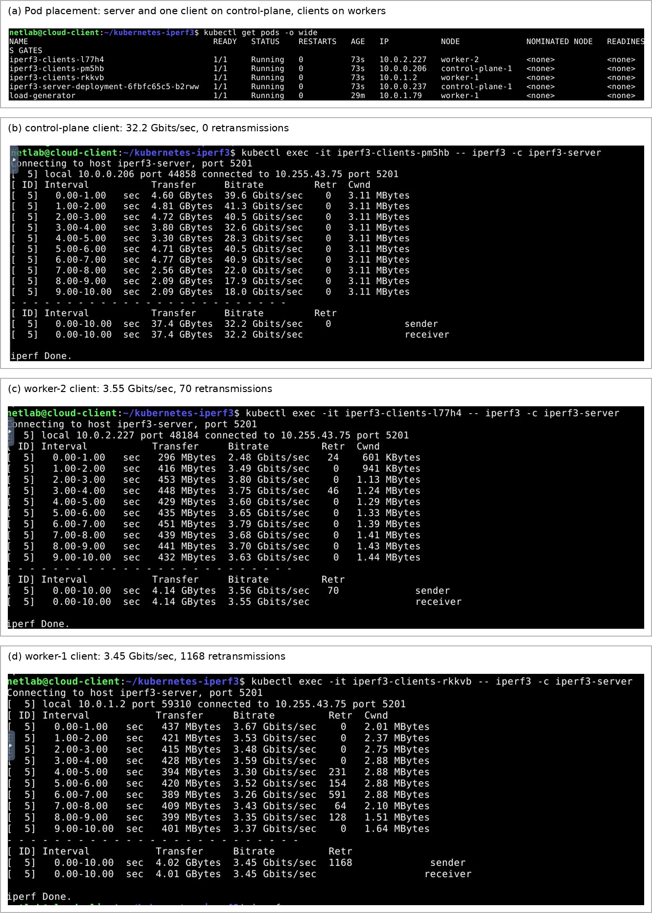

<div align="center">

# Kubernetes Orchestration & Network Performance

**Container Orchestration · Service Networking · Persistent Storage · Autoscaling · Network Benchmarking**

*Mobile and Sensor Networks · Politecnico di Torino · 2025/26*

</div>

## Overview

This project explores **Kubernetes orchestration and network performance** through practical experiments with containerized workloads. It covers how Kubernetes maintains application availability, exposes services, preserves state, manages resources, scales under load, and routes traffic across cluster nodes.

The experiments use a cluster with **one control-plane node, two worker nodes, and a separate management workstation**, combining Kubernetes manifests, command-line scripts, packet-level observations, and throughput benchmarks.

### Key technologies

**Kubernetes** · **Docker/container images** · **NGINX** · **MySQL** · **Horizontal Pod Autoscaler (HPA)** · **iperf3** · **YAML** · **Linux** · **kubectl**

## Experiments and results

| Area | Experiment | Result |
|:--|:--|:--|
| **Self-healing** | Four-replica NGINX Deployment | Readiness recovered from **3/4** to **4/4** after a pod was deleted |
| **Service networking** | ClusterIP vs. NodePort | NGINX was accessible from the management VM through **NodePort 30100** |
| **Persistent storage** | MySQL with a 1 GiB PersistentVolume and PVC | The `trains` database remained available after the pod was recreated |
| **Resource management** | CPU requests and limits | CPU consumption was reduced from approximately **1000m to 300m** |
| **Autoscaling** | CPU-based HPA with a 27% utilization target | Application scaled to **7 replicas** under load and returned to **1** |
| **Network benchmarking** | `iperf3` across cluster nodes | Same-node throughput exceeded inter-node throughput |

## Cluster architecture

```text
             Management Workstation / Client VM
                            |
                      kubectl / HTTP
                            |
                +-----------------------+
                | Kubernetes Cluster    |
                |                       |
                | Control-plane node    |
                | iperf3 server         |
                +-----------+-----------+
                            |
                 Cluster networking
                       /         \
              Worker 1           Worker 2
              NGINX pods         NGINX pods
              iperf3 client      iperf3 client
                                 MySQL + local PV
```

The examples demonstrate **Deployments, Services, PersistentVolumes, PersistentVolumeClaims, DaemonSets, and HorizontalPodAutoscalers**.

## 1. Deployment self-healing and service exposure

A four-replica NGINX Deployment demonstrates how Kubernetes automatically replaces failed or deleted pods to maintain the desired application state.



Two service types are compared:

- **ClusterIP** provides an endpoint within the cluster network.
- **NodePort** makes the service reachable through a node address and port **30100**.


## 2. Persistent storage with MySQL

A MySQL Deployment uses a **1 GiB local PersistentVolume**, a **PersistentVolumeClaim**, and a `ReadWriteOnce` volume mounted at `/var/lib/mysql`.

The persistence experiment creates a `trains` database, deletes the MySQL pod, and verifies that the database remains available when Kubernetes starts a replacement pod.



## 3. CPU resource management and autoscaling

Resource-management experiments compare unrestricted CPU usage with a workload configured for:

- **CPU request:** `150m`
- **CPU limit:** `300m`

The **Horizontal Pod Autoscaler** experiment uses `php-apache` and a **27% CPU utilization target**. Under load, the Deployment reached **7 replicas**; after the load stopped, it scaled down to **1 replica**.



## 4. Network throughput with iperf3

An `iperf3` server runs on the control-plane node, while a **DaemonSet** places benchmarking clients on cluster nodes. A ClusterIP Service provides a stable server endpoint.

| Client location | Throughput | TCP retransmissions |
|---|---:|---:|
| Control-plane (same node as server) | **32.2 Gbit/s** | **0** |
| Worker 2 | **3.55 Gbit/s** | **70** |
| Worker 1 | **3.45 Gbit/s** | **1,168** |



The comparison illustrates the performance difference between **local pod communication** and **inter-node traffic**, which traverses additional network layers. Throughput varies with cluster topology and available hardware.

## Getting started

### Requirements

- Linux or another environment with `bash` and `kubectl`
- Access to a Kubernetes test cluster with a control-plane node and two worker nodes
- A running **metrics-server** for CPU monitoring and autoscaling
- Permission to create Deployments, Services, storage resources, and DaemonSets
- A node named `worker-2` with an appropriately prepared `/data` directory for the local MySQL volume

The scripts use your **current Kubernetes context**. Review the manifests and run them on a test cluster where you have appropriate permissions.

### Run the experiments

```bash
# Inspect the current cluster
bash scripts/00-check-cluster.sh

# NGINX availability and service networking
bash scripts/01-nginx-self-healing.sh

# MySQL persistent storage
bash scripts/02-mysql-secret.sh
bash scripts/03-mysql-persistence.sh

# CPU resource management
bash scripts/04-cpu-limits.sh

# Horizontal Pod Autoscaling
bash scripts/05-hpa.sh

# Network performance benchmarking
bash scripts/06-iperf3-benchmark.sh
```

> **Storage setup:** Prepare `/data` on the designated storage node before running the MySQL experiment. The PersistentVolume uses a `Retain` policy, so its underlying data is not automatically deleted when a pod is removed.

### Clean up

```bash
bash scripts/99-cleanup.sh
```

The cleanup script leaves MySQL storage and its Secret in place to avoid accidental data loss. Remove those resources separately when no longer needed.

### Check the configuration files

```bash
python -m pip install -r requirements-dev.txt
python -m unittest discover -s tests -v
```

The tests check YAML structure and relationships between Kubernetes resources.

## Project structure

```text
.
├── manifests/
│   ├── nginx/          # NGINX Deployment and Services
│   ├── mysql/          # PersistentVolume, PVC, MySQL Deployment
│   ├── resources/      # CPU stress workloads
│   ├── hpa/            # Autoscaling configuration
│   └── iperf3/         # Benchmark server and client DaemonSet
├── scripts/            # Experiment and cleanup commands
├── docs/
│   ├── images/         # Screenshots and experiment figures
│   ├── report/         # Laboratory report
│   └── EXPERIMENTS.md  # Experiment details and configuration notes
├── tests/              # YAML consistency checks
└── README.md
```

## Contributors

**Politecnico di Torino — Mobile and Sensor Networks **  
** Tala Hareb · Ahmad Mansour · Malak E. M. Alashi · Zaynab Hojeij

## References

- [Kubernetes documentation](https://kubernetes.io/docs/home/)
- [Deployments](https://kubernetes.io/docs/concepts/workloads/controllers/deployment/)
- [Services](https://kubernetes.io/docs/concepts/services-networking/service/)
- [Persistent Volumes](https://kubernetes.io/docs/concepts/storage/persistent-volumes/)
- [Horizontal Pod Autoscaling](https://kubernetes.io/docs/tasks/run-application/horizontal-pod-autoscale/)
